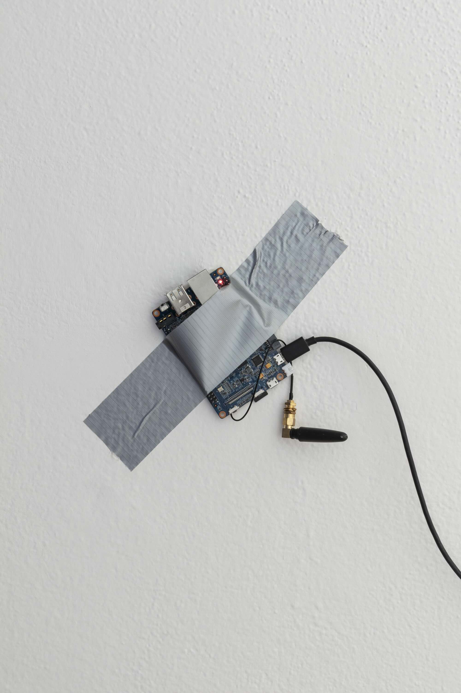

+++
title = 'Dotcomedian.com (a social network)'
date = 2026-09-14T00:05:48+01:00
draft = false
tags = ["self-hosting", "installation", "social networks", "digital sovereignty", "infrastructure"]
description = "An artwork as a social network running on a 12-year-old mini-computer that costs 12 euros."
+++
Dotcomedian.com (a social network) [2025] is an ironic work of art that invites viewers to contemplate and practically experience what a social network is and what the physical forms of its infrastructure can look like.
The work presents the viewer with a social network literally glued to the wall right before their eyes, while also being accessible online on their smartphone at the domain specified in its title: [dotcomedian.com](https://dotcomedian.com).
It thus creates a contrast between the widespread perception of a social network as a massive Moloch and a low-tech implementation running on a more than 10-year-old BananaPi M1+ single-board computer worth 12 euros.

Here, a social network isn’t a gigantic megastructure made up of dozens of massive data centers, but rather a somewhat low-key, almost unobtrusive, minimalist technology.
Even so, visitors can connect to hundreds of thousands of users on the decentralized Fediverse network—all via technology held together with ordinary adhesive tape and powered by a standard USB smartphone charger.
In Dotcomedian.com, the social network thus resembles a mundane everyday object, much like the banana in Maurizio Cattelan’s installation *Comedian*, to which the work refers through its title, installation, and the computer used.
